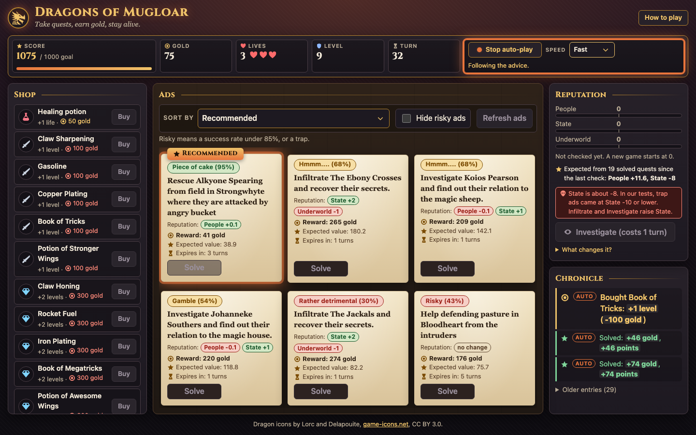
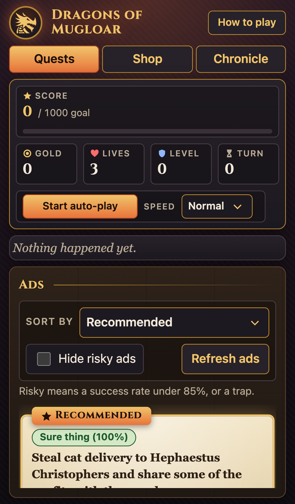

# Dragons of Mugloar

Solution for both tasks of the Bigbank home assignment:

1. **Bot**: a program that plays the Dragons of Mugloar game and tries to reach a score of 1000.
2. **Web app**: a Vue site where a person plays the game, or turns on auto-play and watches each move.

## Screenshots

Desktop, with auto-play on. The advised ad has the "Recommended" tag. Each ad shows its reputation effect.



Phone (iPhone 13 viewport). The game sections are in 3 tabs: Quests, Shop and Chronicle.



## Quick start

Docker (needs ports 3100 and 5173 free):

```bash
docker compose up --build
```

Open <http://localhost:5173>. The API is at <http://localhost:3100/api>, and the API docs are at
<http://localhost:3100/api/docs>.

Local (Node 24, see `.nvmrc`):

```bash
npm ci
npm run dev
```

This starts the backend (port 3100) and the frontend (port 5173). `npm run dev` uses
`concurrently`, because `npm --workspaces` runs the scripts one after the other.

Backend only (the frontend is not necessary):

```bash
npm ci
npm run start:dev -w backend
```

Then play a game with `curl`:

```bash
curl -X POST http://localhost:3100/api/games
curl http://localhost:3100/api/games/<gameId>/ads
curl -X POST http://localhost:3100/api/games/<gameId>/ads/<adId>/solve
```

The `advice` field of the ads answer gives the next action of the bot strategy. You can also try each
endpoint in the Swagger UI at <http://localhost:3100/api/docs>.

## Run the bot

```bash
npm run bot -- --games 5 --max-turns 200
```

The bot plays the games one after the other. For each game it prints the gameId after the first
turn and the result at the end. Then it prints a summary:

```
Game 1/5 started: <gameId>
Game 1/5 <gameId>: score 1234, turn 200, level 270, lives 9, gold 410 (max-turns)
Summary: games 5, min ..., median ..., max ..., games >= 1000: N/5, failed: 0
```

Defaults: 1 game, 1000 turns. The summary counts the games that reached 1000 points.

For a long run, add `--progress-every N`. The bot then also prints one line every N turns
(turn, level, lives, gold, score):

```bash
npm run bot -- --games 1 --max-turns 100000 --progress-every 500
```

## Auto-play in the web app

The Play screen has a **Start auto-play** button and a speed choice (Slow, Normal, Fast: 1500, 700 or
250 ms for each step). Each step does these things:

1. Read the `advice` that came with the last `GET /games/:gameId/ads` answer.
2. Show the move: the advised ad card or the shop item glows for 40% of the step (at least 150 ms).
3. Run the same store action that a click runs (`solve` or `buy`). The HUD, the ads, the shop and the
   chronicle change as in manual play. The chronicle marks these entries with an "Auto" tag.

Auto-play stops at game over, on an error, when there is no advice, or when you press Stop. A click on any
game button also stops auto-play first, and then runs that action. Only one request runs at a time.

The strategy stays in the backend. The frontend only follows the advice, so there is no new endpoint.
The bot program of the backend task is the CLI above. The web app does not need it.

## Tests

| Command               | What it runs                                                             |
| --------------------- | ------------------------------------------------------------------------ |
| `npm test`            | Unit tests of the backend (Jest) and the frontend (Vitest)               |
| `npm run test:cov`    | Unit tests with a coverage report for each workspace (`*/coverage/`)     |
| `npm run test:e2e`    | Backend end-to-end test against the **real** game API (needs network)    |
| `npm run test:e2e:ui` | Playwright smoke test in Chromium, Firefox, WebKit and a mobile viewport |
| `npm run lint`        | ESLint and Prettier for both workspaces                                  |

The Playwright test mocks the backend with `page.route`, so it never calls the real game API.
It plays one game by hand, and it starts auto-play, sees one move, and stops it.
Install the browsers once with `npx playwright install chromium firefox webkit`.
CI runs everything except `test:e2e`, because that test depends on an external service.

## Architecture

```
Browser (Vue 3)    --REST-------->  NestJS backend  --HTTP-->  Dragons of Mugloar game API
CLI (npm run bot)  --runs playGame() directly, HTTP-->  Dragons of Mugloar game API
```

```
backend/src/
  games/      REST endpoints for a game (start, ads, solve, shop, buy, reputation),
              and the measured reputation effect of each ad type
  bot/        the game loop play-game.ts, used by the CLI
  strategy/   pure decision function: which action is next
  mugloar/    HTTP client, response schemas and ad decoding for the game API
  common/     error filter, validation helper, OpenAPI docs
  cli.ts      the bot as a command line program
frontend/src/
  api/        fetch client and response types
  stores/     Pinia store: game (one place for every request and error)
  composables/ useAutoPlay: auto-play follows the advice of the backend
  components/ ads, shop, status bar, auto-play controls, reputation, chronicle
  utils/      pure helpers: ad sorting and risk, reputation math, icons
e2e/          Playwright smoke test with a mocked backend
```

## REST API

All paths start with `/api`. The full OpenAPI docs, with the response and error schemas, are at
`/api/docs` (Swagger UI) and `/api/docs-json`. The docs are made from the same classes that the
code uses to check the data, so they stay correct when the code changes.

| Method | Path                              | Description                                 |
| ------ | --------------------------------- | ------------------------------------------- |
| GET    | `/health`                         | Health check                                |
| POST   | `/games`                          | Start a new game                            |
| GET    | `/games/:gameId/ads`              | List the ads and the advised next action    |
| POST   | `/games/:gameId/ads/:adId/solve`  | Solve an ad                                 |
| GET    | `/games/:gameId/shop`             | List the shop items                         |
| POST   | `/games/:gameId/shop/:itemId/buy` | Buy an item                                 |
| POST   | `/games/:gameId/reputation`       | Investigate the reputation (costs one turn) |

`GET /games/:gameId/ads` answers `{ "ads": [...], "advice": ... }`. The advice is the next action of the
strategy: `{ "type": "solve", "adId": "..." }`, `{ "type": "buy", "itemId": "..." }`, or `null` for a game
that the backend does not know.

Each ad has the fields of the game API and 4 more fields that the backend adds:

| Field              | Description                                                                   |
| ------------------ | ----------------------------------------------------------------------------- |
| `successRate`      | The measured success rate of the difficulty label (0 to 1)                    |
| `expectedValue`    | `reward * successRate`                                                        |
| `isTrap`           | `true` for a "Steal super awesome diamond" ad, which always fails             |
| `reputationEffect` | `{ people, state, underworld }` change after a success, or `null` (not known) |

## Reputation effect of an ad

The game does not tell how an ad changes the reputation. I measured it: a reputation check after each of
about 300 solved ads. Each ad type gave the same change in every sample, at all tested levels (0 to 18).
A failed ad changes nothing. The rules are in `backend/src/games/reputation-effect.ts`.

The web app uses these rules in 2 places:

- Each ad card shows its effect, for example "State +2, Underworld -1".
- The reputation box adds up the effects of the solved ads since the last check. It warns when State
  is near -10, because trap ads came at State -10 or lower in the tests.

## How the strategy works

The code is in `backend/src/strategy/strategy.ts`. It is one pure function, `decideNextAction`.

- The success rate of each difficulty label was measured on the real API, and it is a constant table.
- When lives are 2 or fewer and gold is 50 or more, buy a healing potion.
- Never solve a trap ad ("Steal super awesome diamond"). It failed every time in the measurements.
- Stop solving "Steal" ads after 4 successes. Each one lowers the State reputation by 2, and trap ads
  came when State reached -10.
- Keep the level above `1.3 * (turn + 10)` by buying level items, so the ads stay easy.
- Buy the 5 items of a tier in turn. Each item trains another skill. With one item only, the ads got
  hard at turn 55 and every game ended before turn 100.
- Buy +1 items only below level 10. After that, buy +2 items, because they give more levels per turn.
- Keep 50 gold after a level item, so that a potion is still possible.
- Solve the safe ad (success rate 0.85 or more) with the best score:
  `reward * rate - (1 - rate) * (50 + average reward)`. A lost life costs a potion and a turn.
- When no ad is safe, buy a level item if gold allows. Otherwise take the ad with the best score.
- At 2 lives or fewer, take the ad with the best chance.

## Results

All runs use the real game API (November 2026).

| Run                         | Command                                                             | Result                                                          |
| --------------------------- | ------------------------------------------------------------------- | --------------------------------------------------------------- |
| Reliability (200-turn cap)  | `npm run bot -- --games 20 --max-turns 200`                         | 20 / 20 games >= 1000 points                                    |
| Long run (100,000-turn cap) | `npm run bot -- --games 10 --max-turns 100000 --progress-every 500` | **1,853,032,670 points** at turn 33,500, 3 lives, stopped by me |

### Reliability benchmark (stops each game at turn 200)

| Games | Score >= 1000 | Reached turn 200 | Min score | Median score | Max score at turn 200 |
| ----- | ------------- | ---------------- | --------- | ------------ | --------------------- |
| 20    | 20 / 20       | 14 / 20          | 9,018     | 33,756       | 36,691                |

- Every game passed 1000 points. A game passes 1000 points at about turn 30.
- 6 games ended between turn 108 and turn 184. In these games the level fell behind the turn count,
  and the ad list had no safe ad left.
- The cap of 200 turns keeps the benchmark short (about 2 minutes for each game). Without a cap,
  a game that keeps its lives goes on, and the score grows with the square of the turn count.

### Long run

The first game ended at turn 142. The second game reached a score of 1,853,032,670 at turn 33,500 (about 5 hours 45 minutes)
with 3 lives left. I stopped it there. This is higher than the top score on the game site (1,019,978,705).

## Error handling and validation

- The backend reads its settings with class-validator at startup and stops on an invalid value.
- Every path parameter is validated with class-validator (a global `ValidationPipe`). A bad value gives a 400 error. No endpoint takes a body.
- Every error has one JSON shape: `{ statusCode, error, message }`.
- Game errors have clear codes: `GAME_NOT_FOUND`, `AD_NOT_FOUND`, `GAME_OVER` (410),
  `UPSTREAM_RATE_LIMITED` (429), `UPSTREAM_UNAVAILABLE` (502), `UPSTREAM_TIMEOUT` (504).
- The game API replies are checked with class-validator. An unexpected reply becomes an error.
- Starting a game is rate limited (10 per minute for each client).
- The frontend shows the error message and disables the buttons while a request runs.

## Key decisions and trade-offs

- **No database.** Game state lives in the game API. The backend keeps only a small in-memory cache
  of known games, for the advice.
- **No retry of non-idempotent calls.** Solve, buy and reputation spend a turn. When no answer comes
  (timeout or network error), a second send could spend a second turn, so the client reports the error.
  Start and the GET calls are retried. A 429 reply is retried for every call, because the game did not act.
  A 5xx reply is also retried. A proxy error does not prove that the game did not act, so a retried solve
  can spend one more turn. In this game that cost is small. A bank transfer would need an idempotency key.
- **Auto-play in the browser, not a bot tab.** The frontend follows the advice of the backend and runs
  the same actions as a click. There is one screen and one source of strategy. Long runs stay in the
  CLI.
- **No shared package.** The frontend copies the API types. It is a little duplication, but there is
  one less package to build and explain.
- **Pure strategy function.** It has no I/O, so unit tests are simple and fast.

## How AI was used

I used Claude Code (an AI coding agent) for most of the typing, in a controlled agentic workflow.

- **I made the decisions.** I chose the scope, the stack (NestJS and Vue, the stack of the team),
  the architecture and the strategy rules. Each decision has a written reason.
- **Measure first.** Agents wrote small probe scripts that played real games and logged the results.
  The strategy uses these measured numbers (success rate for each label, trap ads, shop effects),
  not guesses.
- **Small, separate tasks.** One agent for each part: game probes, backend, frontend, infrastructure,
  strategy tuning. Each task had clear limits and a check at the end (lint, tests, build).
- **Independent review.** A separate agent reviewed the full code. I read its findings and fixed
  the clear ones. Some trade-offs stay on purpose (see "Key decisions and trade-offs").
- **What AI got wrong.** The first bot bought only one item type and died before turn 100.
  The logs showed the cause: each item trains a different skill. The fix was to buy all items in turn.

## Credits

The frontend uses these free assets. The SVG files are in `frontend/src/assets/`. I removed the black
background and changed the fill color to gold.

| Asset                                    | Author                     | Source                                                        | License     |
| ---------------------------------------- | -------------------------- | ------------------------------------------------------------- | ----------- |
| Spiked dragon head (`dragon-head.svg`)   | Delapouite                 | https://game-icons.net/1x1/delapouite/spiked-dragon-head.html | CC BY 3.0   |
| Wyvern (`wyvern.svg`)                    | Lorc                       | https://game-icons.net/1x1/lorc/wyvern.html                   | CC BY 3.0   |
| Cinzel font (`@fontsource/cinzel` 5.3.0) | The Cinzel Project Authors | https://fontsource.org/fonts/cinzel                           | SIL OFL 1.1 |

CC BY 3.0: https://creativecommons.org/licenses/by/3.0/
